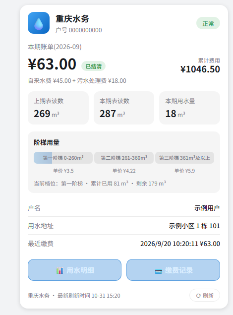
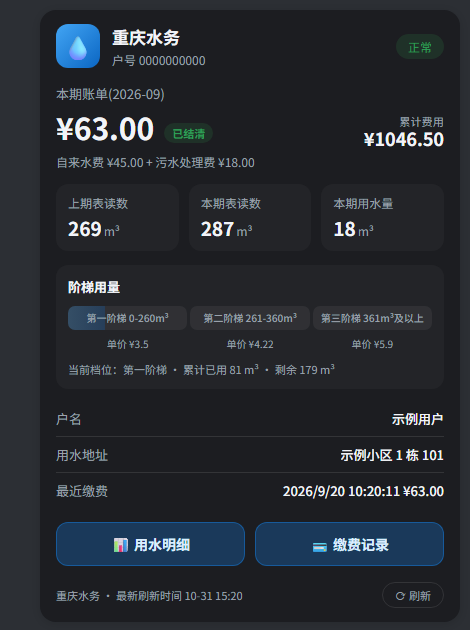
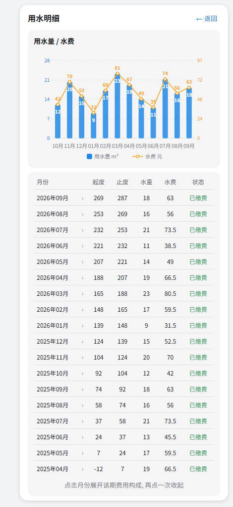
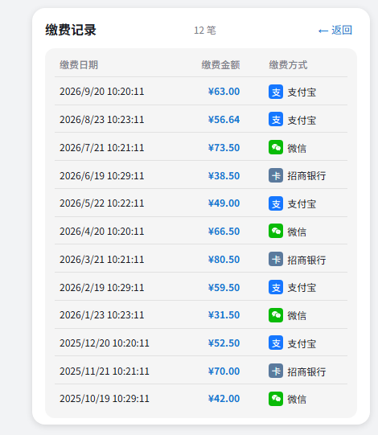
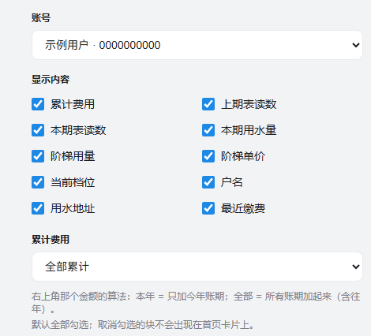

# 重庆水务 Home Assistant 集成

[](https://github.com/hacs/integration)
[](LICENSE)

把「重庆水务掌上水务」网页版（kf.cncqsw.com）里的数据接进 Home Assistant，并自带一张 Lovelace 卡片：
本期账单、三枚读数磁贴、阶梯用量、逐月账期、缴费记录，一次装好就能看。

仓库：<https://github.com/ranqingwen/cqsw_water>

> 非官方集成，与重庆水务集团及其关联公司没有任何关系。只用于查询自己账号下的数据，请勿高频请求。

---

## ✨ 功能特性

- **UI 配置，一键添加**：账号 + 密码即掌上水务网页版那套登录方式，SM2 握手加密、会话密钥协商、户号识别全部由集成自动处理
- **12 个数据实体 + 3 个诊断实体**：本期水费 / 水量、上期与最新读数、本年累计用量、全部 / 本年累计费用、账单月份、缴费情况、最近缴费金额与时间等
- **本地缓存只增不删**：在线接口通常只回最近一年，缓存按月账期和缴费日合并，用得越久历史越长；断网、登录失败时自动回落缓存继续显示
- **自带 Lovelace 卡片**：主视图 + 用水明细（柱线图 + 账期表）+ 缴费记录，三处入口都在卡片里，随 HA 主题自动明暗
- **可视化编辑器**：10 项「显示内容」勾选（默认全开）+ 累计口径下拉（本年 / 全部），不用写 YAML
- **费用构成可展开**：点任意月份展开该期的「自来水费 / 污水处理费 · 单价 × 水量」明细
- **静默升级**：卡片随集成安装，集成启动时自动注册前端资源，`?v=` 指纹按卡片内容自动更新，升级只需覆盖文件夹
- **品牌图标**：`brand/` 自带 logo，HA 2026.3+ 在「添加集成」和设备页自动显示
- **零第三方依赖**：国密 SM2 / SM3 用纯 Python 标准库实现，`manifest.json` 不声明任何 `requirements`

## 🖼️ 界面预览

> 以下截图使用仓库内 `preview.html` 的**模拟数据**生成，户名、户号、地址均为示例值。

| 主页（亮色） | 主页（暗色） |
|---|---|
| [](docs/card-light.png) | [](docs/card-dark.png) |
| 本期账单、三枚读数磁贴、阶梯用量、户名地址与两个入口 | 跟随 HA 主题自动切换深色，无独立配色 |

| 用水明细 | 缴费记录 |
|---|---|
| [](docs/usage.png) | [](docs/payment.png) |
| 用水量柱状 + 水费曲线双轴图，点月份展开该期费用构成 | 每笔缴费的日期 / 金额 / 扣款渠道（微信、支付宝、银行） |

| 卡片编辑器 | |
|---|---|
| [](docs/editor.png) | |
| 「显示内容」10 项勾选默认全开，下方可选累计口径（本年 / 全部） | |

## 📦 安装

### 方式 A：HACS（自定义仓库）

1. HACS → 集成 → 右上角 ⋮ → 自定义存储库
2. 地址填 `https://github.com/ranqingwen/cqsw_water`，类别选「集成」
3. 搜索「重庆水务」安装，重启 Home Assistant

### 方式 B：手动

把 `custom_components/cqsw_water` 整个目录复制到 HA 的 `config/custom_components/` 下，重启 Home Assistant。

> 卡片就在这个目录里（`custom_components/cqsw_water/www/cqsw-water-card.js`），**不需要**再往 `config/www/` 复制，
> 也不需要手工添加前端资源——集成启动时会自动完成。
> **升级同理：覆盖 `custom_components/cqsw_water` 整个文件夹、重启 HA 即可。**
> 资源地址里的 `?v=` 由集成每次启动按「版本号 + 卡片内容指纹」自动生成并写回 Lovelace，不用改 URL、不用清缓存。

依赖：无。SM2 / SM3 与 HTTP 请求分别用标准库 `hashlib` / `urllib` 自实现，安装后不会额外拉取任何 Python 包。

> 品牌图标放在 `custom_components/cqsw_water/brand/`（`icon.png` 256×256、`logo.png` 512×512，白底原图）。
> HA 2026.3 及以上会自动在「添加集成」列表和设备页显示；更老的版本退回默认图标，不影响使用。

## 🚀 快速开始

1. 设置 → 设备与服务 → 添加集成 → 搜索「重庆水务」
2. 填账号和密码，顺手确认三个阶梯水价（接口不返回分档单价，默认是重庆中心城区居民一户一表标准）
3. 添加完成后首次数据在后台拉取（十几秒，不阻塞 HA 启动），之后直接添加卡片：

```yaml
type: custom:cqsw-water-card
entity: sensor.zhong_qing_shui_wu_13800000000_zui_xin_du_shu   # 主实体（最新读数），实际 ID 以你的为准
# hide: [cumulative, prev_reading, reading, usage, ladder, tier_prices, tier_status, name, address, last_pay]
# cum_scope: year   # 右上角累计费用只算今年；不写就是全部账期
```

只有一个账号时 `entity` 可以省略，卡片会自动选中；多账号时在卡片编辑器的「账号」下拉框里选。

## ⚙️ 配置说明

### 集成选项（集成 → 配置）

| 项 | 说明 |
|---|---|
| 账号 | 掌上水务登录账号，一般不用改 |
| 密码 | **留空表示不修改**（重新配置时） |
| 自动刷新间隔 | 滑条 12–48 小时，默认 12（水量一个月才变一次，刷太勤没意义） |
| 第一 / 二 / 三档单价 | 元/m³，卡片阶梯标注与费用构成都用它 |

默认阶梯水价（重庆中心城区居民「一户一表」，**仅供参考**，可按当地水司公示价格改）：

| 档位 | 年用水量 | 水价（综合单价） |
|---|---|---|
| 第一档 | 0–260 m³（含） | 3.50 元/m³ |
| 第二档 | 260–360 m³（含） | 4.22 元/m³ |
| 第三档 | 360 m³ 以上 | 5.90 元/m³ |

### 实体

| 实体 | 含义 | 备注 |
|---|---|---|
| `sensor.…_hu_hao` | 户号 | 属性带户名 / 地址 / 用水性质 |
| `sensor.…_zui_xin_du_shu` | **最新读数** | m³，**主实体**，卡片挂它，逐月账期 / 缴费记录 / 费用构成全在属性里 |
| `sensor.…_shang_qi_du_shu` | 上期读数 | m³，本期起度 |
| `sensor.…_ben_qi_yong_shui_liang` | **本期水量** | m³ |
| `sensor.…_ben_qi_shui_fei` | **本期水费** | 元，只含这一期水费 |
| `sensor.…_ben_nian_lei_ji_yong_liang` | 本年累计用量 | m³，接口的阶梯年度用量，跨年归零 |
| `sensor.…_quan_bu_lei_ji_fei_yong` | **全部累计费用** | 元，缓存里所有账期（含往年）水费之和 |
| `sensor.…_ben_nian_lei_ji_fei_yong` | 本年累计费用 | 元，只算账期落在今年的那些期 |
| `sensor.…_zhang_dan_yue_fen` | 账单月份 | 如 `2026-09` |
| `sensor.…_zui_jin_jiao_fei_jin_e` | 最近缴费金额 | 元 |
| `sensor.…_zui_jin_jiao_fei_shi_jian` | 最近缴费时间 | 带时刻，如 `2026/9/20 10:20:11` |
| `sensor.…_jiao_fei_qing_kuang` | 缴费情况 | 已缴费 / 待缴费 |
| `sensor.…_shu_ju_lai_yuan` | 数据来源 | 诊断：在线获取 / 本地缓存 |
| `sensor.…_deng_lu_zhuang_tai` | 登录状态 | 诊断：在线 / 离线 |
| `sensor.…_zui_xin_shua_xin_shi_jian` | 最新刷新时间 | 诊断：最近一次在线刷新成功的时间，卡片页脚那行就是它 |

实体 ID 会随 HA 语言和命名规则变化，以实际为准；卡片自动查找主实体，不用手填。

> 设备页里实体的**显示顺序由 HA 前端决定**（按本地化名称排序），集成无法指定。想固定顺序只能用自定义 `entities` 卡片。

### 卡片配置

编辑器里的「显示内容」默认全部勾选，取消哪个首页就少哪一块；勾选状态存在卡片的 `hide` 数组里，
**全部勾选时代码保持干净，一个开关都不写**。

| key | 对应内容 |
|---|---|
| `cumulative` | 右上角的累计费用金额 |
| `prev_reading` | 上期表读数磁贴 |
| `reading` | 本期表读数磁贴 |
| `usage` | 本期用水量磁贴 |
| `ladder` | 阶梯用量整块（标题 + 三档进度条 + 单价 + 当前档位） |
| `tier_prices` | 阶梯块里的三个单价（三档一起） |
| `tier_status` | 阶梯块里的「当前档位 · 累计已用 · 剩余」 |
| `name` | 户名 |
| `address` | 用水地址 |
| `last_pay` | 最近缴费 |

右上角累计费用有两个口径，编辑器里用下拉框切换：

| `cum_scope` | 含义 | 卡片标签 |
|---|---|---|
| 不写 / `all` | 所有账期加起来（含往年），默认 | `累计费用` |
| `year` | 只加今年账期，与阶梯用量同一年度口径 | `本年累计` |

阶梯单价默认取添加集成时填的三档，临时覆盖可写在卡片里：

```yaml
type: custom:cqsw-water-card
ladder_prices: [3.5, 4.22, 5.9]
```

### 多个账号

1. 再走一次「添加集成 → 重庆水务」，填另一个账号和密码即可
2. 每个账号生成**独立条目、独立设备、独立实体**，缓存按户号分开存，互不影响
3. 卡片是「一张卡片一个账号」：编辑器「账号」下拉框只列出本集成的主实体（显示为「户名 · 户号」），选哪个显示哪个

同一账号重复添加会被拦下。

## 🗂️ 本地缓存

位置：`config/cqsw_water_data_<户号>.json`（普通 JSON，缩进格式化，可手工编辑，改完重载集成生效）。

- `monthList` 以月份为键、`rechargeList` 以「缴费日 + 金额 + 方式」为键，**只增不删**；同一键用新值覆盖非空字段（例如「未缴费」变「已缴费」）
- 在线没返回的旧月份原样保留，所以用得越久历史越长；换账号时删掉旧文件即可重来
- 在线成功：合并 → 写盘 → 实体属性取自合并结果；在线失败：内存 → 缓存文件依次回落，`数据来源 = 本地缓存`
- 内容没有实际变化时不写盘，`date` 字段即本文件最近一次数据变化的时间

样例结构：

```jsonc
{
  "date": "2026-09-20 10:20:11",
  "account": "13800000000",
  "card_no": "0000000001",
  "consumer_name": "示例用户",
  "consumer_addr": "示例小区 1 栋 101",
  "reading": 287.0,
  "monthList": [
    { "month": "2026年09月", "monthWaterNum": 18.0, "monthWaterCost": 63.0,
      "beginScale": 269.0, "endScale": 287.0, "isPay": true,
      "feeItems": [ { "item": "自来水费", "price": 3.5, "amount": 18.0, "money": 63.0 } ] }
  ],
  "rechargeList": [
    { "amount": 63.0, "pay_date": "2026/9/20 10:20:11", "pay_mode": "支付宝" }
  ],
  "statistics": { "months": 18, "total_water": 1234.0, "total_cost": 2345.0, "payments": 23 }
}
```

## 🔧 接口与实现

查询走掌上水务网页版（`kf.cncqsw.com/sw-cloud`）的同一套接口，请求与响应均加密：

- 登录：`POST /system-service/unAuth/normalLogin?tenantId=`，密码用前端硬编码公钥做 SM2 加密，返回 `token` 后以 Cookie `CCS_SESSION_ID` 鉴权
- 会话密钥：`GET /system-service/security/rule` 下发 encodeKey / decodeKey，是 HEX 编码的 SM2 密文，用前端硬编码私钥解出「请求体加密公钥」和「响应解密私钥」
- 业务接口：`getCardNo`（户号）、`waterDetail/map/<cardNo>`（用水明细 + 阶梯）、`queryPayRecrod`（缴费记录，请求体整体 SM2 加密）、`waterDetail/detail?desensitize=0`（单月账单 + 费用构成）

几个踩过的坑：响应密文是 **Base64-URL-Safe**；`queryPayRecrod` 的 `Content-Type` 必须是 `application/json` 否则直接 415；
会话密钥偶发解不开（集成内置多条候选逐个尝试）；接口一次只回最近一年，所以历史必须靠本地缓存累积。

## 🛠️ 项目结构

```
custom_components/cqsw_water/   集成本体（api / cache / sensor / config_flow / www 卡片 / brand 图标）
docs/                          文档截图（模拟数据）
preview.html                   静态预览页，浏览器直接打开可看卡片效果（支持 ?view=usage / payment / editor、&theme=dark）
```

```bash
# 本地起静态服务看卡片预览（模拟数据）
python -m http.server 8000
# 浏览器打开 http://localhost:8000/preview.html
```

## ❓ 常见问题

| 问题 | 原因 | 处理 |
|---|---|---|
| 首次添加提示失败 | 偶发的会话密钥 / 网络问题导致某次抓取不完整 | 集成会自动回退本地缓存并继续添加，下个刷新周期自动恢复在线 |
| 改了账号密码 | — | 条目 ⋮ → 重新配置（密码留空表示不改）；或删掉重加 |
| 启动后前十几秒实体「不可用」 | 首次刷新在后台执行，不阻塞 HA 启动 | 属于预期行为，数据拉取完成后实体自动恢复 |
| 卡片空白 | 资源没注册 / 浏览器旧缓存 | 重启 HA 后刷新页面；资源列表里应有 `/cqsw_water/www/cqsw-water-card.js` |
| 集成图标不显示 | HA < 2026.3 | 本地品牌图标机制需要 2026.3+，老版本退回默认图标，不影响功能 |
| 卡片显示「请选择账号」或空白 | 多账号又没指定 `entity` | 编辑卡片，从「账号」下拉框选一个即可 |
| 阶梯二 / 三档单价显示 `-` | 接口只给分档区间、不给单价 | 单价来自添加集成时填写的三个值，或卡片 `ladder_prices` 覆盖 |
| 接口改版了怎么办 | 网页端字段变动 | 看 HA 日志里 SM2 解密 / 字段缺失的报错，对照 `api.py` 的候选字段名补上新键 |

## ⚠️ 免责声明

- 本项目为个人自用工具，与重庆水务集团及其关联公司无关
- 接口为网页端私有接口，可能随时变更或关闭，不保证长期可用
- 请勿高频请求，默认 12 小时刷新一次是有意为之
- 因使用本项目造成的一切后果由使用者自行承担

## 📄 License

[MIT](LICENSE) © 2026 [ranqingwen](https://github.com/ranqingwen)
